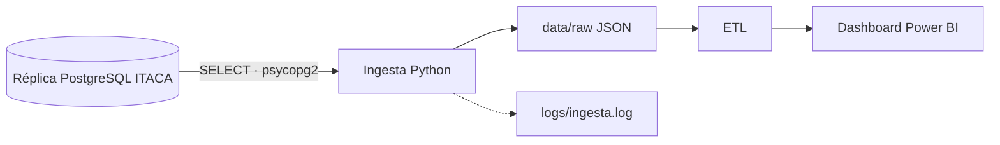

# Proyecto 2 · Analítica académica ITACA (origen base de datos)

> Proyecto del módulo **Big Data aplicado** (IABD). Práctica 2 del Bloque 1: la misma ingesta que la P1, pero leyendo de una réplica **PostgreSQL** por consultas SQL, y con un **logger** propio. Arquitectura batch.

## Descripción y objetivo

Ingestar las tablas académicas de ITACA desde su réplica PostgreSQL (acceso de solo lectura), anonimizar el NIA y dejarlas en la zona `raw` como JSON, listas para la limpieza y el modelo del dashboard.

## Arquitectura



*Diagrama del Bloque 1. Se actualizará al terminar cada bloque.*

## Fuentes de datos

| Fuente | Mecanismo de acceso | Autenticación | Formato | Frecuencia de actualización | Última ingesta |
|---|---|---|---|---|---|
| Réplica PostgreSQL de ITACA, base `itaca_academico` | Conexión directa con `psycopg2` (equivalente Python de JDBC) y `SELECT *` por tabla | Usuario `lectura_bigdata`, solo `SELECT`; credenciales en `.env` (fuera de Git) | Filas relacionales -> JSON | La réplica se sincroniza con ITACA al cerrar cada curso (la de 2025-26 se refresca en cada evaluación); la ingesta se lanza después | 2026-10-29 |

Entorno de desarrollo: no hay acceso a la réplica real, así que se levanta un PostgreSQL 16 en Docker (`bigdata-pg-itaca`) con el mismo esquema y datos de ejemplo cargados desde los XML de la P1 (ya anonimizados por el docente).

### Tablas de origen

| Tabla | Acceso | Campos que se ingestan | Campos descartados |
|---|---|---|---|
| `alumnos` | `SELECT *` | anyo, NIA (anonimizado), sexo, nacionalidad, provincia, municipio, ensenanza, curso, grupo, turno, linea, modalidad, repite, estado_matricula, tipo_matricula, fecha_matricula, fecha_ingreso_centro | `id` (clave técnica). Los datos personales (nombre, apellidos, documento, contacto...) no existen en la réplica |
| `cursos` | `SELECT *` | anyo, codigo, nombre_cas, nombre_val, abreviatura, ensenanza, padre | — |
| `calificaciones` | `SELECT *` | anyo, evaluacion, alumno (NIA anonimizado), ensenanza, curso, contenido, bloque_contenido, nota_numerica, tipo_nota | `id` (clave técnica) |
| `contenidos` (módulos) | `SELECT *` | anyo, codigo, nombre_cas, nombre_val, ensenanza, curso | — |
| `grupos` | `SELECT *` | anyo, codigo, nombre, turno, linea, modalidad | — |

La columna `anyo` (curso académico) está en todas las tablas.

## Estructura del repositorio

| Carpeta / fichero | Contenido |
|---|---|
| `ingesta/ingesta_itaca_bd.py` | Ingesta: `conectar()`, `extraer_tabla()`, `guardar()`, anonimización y validación |
| `ingesta/logger.py` | Logger propio: `crear_logger(nombre)` |
| `sql/01_esquema.sql` | Esquema de las cinco tablas (PK y FK) |
| `sql/02_permisos.sql`, `sql/03_password_lectura.sh` | Usuario `lectura_bigdata` con solo `SELECT` y su contraseña desde `.env` |
| `sql/cargar_datos_ejemplo.py` | Carga de datos de ejemplo desde los XML de la P1 (solo para desarrollo) |
| `etl/`, `dashboard/` | Bloques posteriores |
| `docs/` | Salida de la ingesta y capturas |
| `docker-compose.yml` | PostgreSQL 16 local (`bigdata-pg-itaca`) |
| `.env.example` | Plantilla de variables (el `.env` real no se versiona) |
| `data/raw/`, `logs/` | Salidas locales, fuera de Git |

## Cómo desplegar el entorno

```bash
cp .env.example .env            # y cambia las contraseñas (DB_PASSWORD, DB_ADMIN_PASSWORD)
docker compose up -d            # crea el esquema, el usuario de lectura y espera al healthcheck
python -m venv .venv && source .venv/bin/activate
pip install -r requirements.txt
python sql/cargar_datos_ejemplo.py [ruta/a/exportaciones]   # solo en desarrollo; por defecto ../bigdata-p1-itaca/data/exportaciones
python ingesta/ingesta_itaca_bd.py
```

PostgreSQL queda en `localhost:5432` (si lo tienes ocupado, cambia `DB_PORT` en `.env`). `LOG_LEVEL` (`DEBUG`, `INFO`...) controla el detalle del log. Para empezar de cero: `docker compose down -v`.

## Bitácora de prácticas

### Bloque 0 · Entorno

- Objetivo: repositorio y PostgreSQL local con Docker.
- Pasos realizados: estructura del repo, `.gitignore` del módulo (más `logs/`), `docker-compose.yml` con PostgreSQL 16, esquema SQL y usuario de solo lectura creados automáticamente al primer arranque.
- Problemas encontrados y solución: —
- Resultado: `docker compose ps` con `bigdata-pg-itaca` en estado *healthy*.

### Bloque 1 · Ingesta batch (P2)

- Objetivo: la misma ingesta de la P1, pero desde la base de datos con SQL, con el NIA anonimizado y con registro (logging) de lo que ocurre.
- Pasos realizados:
  1. Análisis de la fuente (sección «Fuentes de datos»).
  2. Entorno: `venv` con `psycopg2-binary`, `python-dotenv` y `pandas`. Credenciales en `.env` (`DB_HOST`, `DB_PORT`, `DB_NAME=itaca_academico`, `DB_USER=lectura_bigdata`, `DB_PASSWORD`), no versionado; `.env.example` sí. El usuario solo tiene `SELECT` (`sql/02_permisos.sql`).
  3. `ingesta/ingesta_itaca_bd.py`: `conectar()` (psycopg2 + `.env`), `extraer_tabla(conexion, tabla)` (`SELECT *` con `RealDictCursor`; la tabla se pasa con `psycopg2.sql.Identifier`, no con f-string), `guardar(datos, nombre)` (`data/raw/<tabla>_<fecha>.json`, UTF-8, `indent=2`, `default=str`) y un `__main__` que conecta, extrae, anonimiza, guarda y cierra la conexión en un `finally`.
  4. Anonimización del NIA: **HMAC-SHA256** con sal secreta en `data/.sal_nia` (fuera de Git), truncado a 10 hex y con caché por NIA, de modo que `alumnos.NIA` y `calificaciones.alumno` reciben el mismo hash.
  5. Logger propio (`ingesta/logger.py`): consola + fichero rotativo `logs/ingesta.log` (1 MB, 3 copias), formato `fecha | nivel | módulo | mensaje` y nivel por `LOG_LEVEL`. Se registran la conexión (sin contraseña), las filas y el tiempo por tabla, las validaciones y los errores (`logger.exception`).
  6. Validación de integridad, con consultas SQL sobre la réplica y otra vez sobre los datos anonimizados que se guardan.
  7. Comprobado que `data/raw/` no contiene datos identificativos, que ningún NIA original aparece y que el usuario `lectura_bigdata` no puede hacer `INSERT`, `UPDATE` ni `DELETE` (`permission denied`).
- Problemas encontrados y solución:
  - El enunciado habla de cuatro y de cinco tablas (y menciona `horas` y `modulos`, que no existen). Se ingestan las cinco que hay, con los mismos campos y nombres que la P1: `alumnos`, `cursos`, `calificaciones`, `contenidos` y `grupos`.
  - No hay acceso a la réplica real: se monta un PostgreSQL en Docker y se cargan los datos de ejemplo de los XML de la P1 con `sql/cargar_datos_ejemplo.py` (usa el usuario propietario, nunca el de lectura).
  - Un alumno puede tener varias matrículas en un curso, así que `alumnos` no tiene clave natural: se usa una clave técnica `id`, que `extraer_tabla` no vuelca. Lo mismo en `calificaciones`.
  - `calificaciones.alumno` no lleva clave foránea hacia `alumnos`: 188 calificaciones de 2023 (9 NIA) no tienen su alumno en la matrícula de ese curso (hueco del origen, igual que en la P1). No se descartan; quedan anotadas para la limpieza del Bloque 2.
  - 54 alumnos no tienen grupo en el origen: se guardan con `grupo = null` y no cuentan como huérfanos.
  - Al ordenar con `ORDER BY 1` los registros salían en distinto orden que en la P1: se ordena por las tres primeras columnas para que la salida sea determinista.
  - Los hashes no coinciden con los de la P1 porque la sal es distinta; es lo esperado (el resto de campos es idéntico).
- Resultado: 5 tablas en `data/raw/` (7 193 alumnos, 413 cursos, 106 814 calificaciones, 1 688 contenidos, 257 grupos), los mismos recuentos que la P1. Todo `contenido` de calificaciones existe en contenidos y todo `grupo` de alumnos existe en grupos. Salida completa en [`docs/salida-ingesta.txt`](docs/salida-ingesta.txt) y en las capturas:

  

  

  Los JSON de `data/raw/` no se suben a Git (están en `.gitignore`); se entregan solo como evidencia local.

## Decisiones técnicas

| Decisión | Alternativa descartada | Motivo |
|---|---|---|
| PostgreSQL con acceso JDBC (en Python, `psycopg2`) | Exportar a XML/CSV y leerlo | Los datos de ITACA son relacionales: claves y relaciones entre tablas, y se puede validar la integridad con SQL |
| Usuario `lectura_bigdata` solo con `SELECT`, y sesión en `readonly` | Usar el propietario de la base | Mínimo privilegio: la ingesta no puede modificar el origen aunque falle |
| Credenciales en `.env` (no versionado) + `.env.example` | Contraseñas en el código o en el compose | No se suben secretos a Git; la contraseña de lectura se aplica desde `.env` con un script de inicio |
| `psycopg2.sql.Identifier` para el nombre de tabla | f-string con la tabla | Evita inyección SQL y errores de comillas |
| HMAC-SHA256 con sal secreta, truncado a 10 hex | Hash simple del NIA | Un hash sin sal de un NIA de 8 cifras se deshace probando todos los valores |
| Módulo propio `logger.py` con fichero rotativo y `LOG_LEVEL` | Solo `logging.basicConfig` | Se conserva histórico en disco sin que crezca sin límite y el nivel se cambia sin tocar el código |
| Huérfanos informados, no descartados | Filtrarlos en la ingesta | La zona `raw` es copia fiel del origen; la limpieza es del Bloque 2 |

## Incidencias resueltas

| Incidencia | Solución |
|---|---|
| Contenedor antiguo `bigdata-postgres` del mismo proyecto de Compose | `docker compose up` lo sustituyó por `bigdata-pg-itaca` (el servicio se llamaba igual); su volumen antiguo sigue sin tocar |
| Orden distinto de `cursos` y `contenidos` respecto a la P1 | `ORDER BY` por las tres primeras columnas y mismo orden de columnas en `contenidos` |
