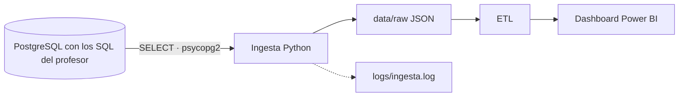

# Proyecto 2 · Analítica académica ITACA (origen base de datos)

> Proyecto del módulo **Big Data aplicado** (IABD). Práctica 2 del Bloque 1: la misma ingesta que la P1, pero leyendo de **PostgreSQL** por consultas SQL, y con un **logger** propio. Arquitectura batch.

## Descripción y objetivo

Ingestar las tablas académicas de ITACA desde PostgreSQL (acceso de solo lectura), anonimizar el NIA, no volcar ningún dato personal y dejarlas en la zona `raw` como JSON, listas para la limpieza y el modelo del dashboard. La base de origen se construye con los cinco ficheros SQL que el profesor da en Aules.

## Arquitectura



*Diagrama del Bloque 1. Se actualizará al terminar cada bloque.*

## Fuentes de datos

| Fuente | Mecanismo de acceso | Autenticación | Formato | Frecuencia de actualización | Última ingesta |
|---|---|---|---|---|---|
| Base PostgreSQL `itaca_academico`, creada y cargada con los 5 SQL del profesor (`alumnos`, `cursos`, `calificaciones`, `contenidos`, `grupos`: export de ITACA del CIPFP Mislata, cursos 2021-22 a 2025-26) | Conexión directa con `psycopg2` (equivalente Python de JDBC) y `SELECT` de columnas explícitas por tabla | Usuario `lectura_bigdata`, solo `SELECT`; credenciales en `.env` (fuera de Git) | Filas relacionales -> JSON | Los SQL son una foto cerrada (el de 2025-26 se exportó el 10/09/2026); en producción se volvería a ingestar tras cada exportación de ITACA | 2026-10-29 |

### Origen de los SQL (no se versionan)

Los cinco ficheros (`alumnos.sql`, `calificaciones.sql`, `contenidos.sql`, `cursos.sql`, `grupos.sql`, en el ZIP adjunto a la tarea de la Práctica 2 en Aules) se descargan de Aules y se dejan, **sin modificar**, en `sql/origen/`. Esa carpeta está en `.gitignore` y no se entrega: aunque los datos vienen ofuscados (letras sustituidas, documentos y teléfonos de relleno), son datos personales de alumnado. Cada SQL hace `DROP TABLE IF EXISTS` + `CREATE TABLE` + `INSERT`, por lo que se cargan con el usuario propietario mediante `sql/cargar_origen.sh`.

### Esquema del origen y qué se ingesta

Todas las columnas de los SQL son `TEXT` salvo `anyo` (`INTEGER`, curso académico: 2021 = 2021-22). No hay claves primarias ni foráneas. Los vacíos vienen como un espacio (`' '`), no como `NULL`.

| Tabla (filas) | Campos que se ingestan | Campos descartados (no se leen de la base) |
|---|---|---|
| `alumnos` (7 193) | `nia` -> **NIA anonimizado**, sexo, nacionalidad, provincia, municipio, ensenanza, curso, grupo, turno, linea, modalidad, repite, estado_matricula, tipo_matricula, fecha_matricula, fecha_ingreso_centro, anyo | Personales: nombre, apellido1, apellido2, fecha_nac, tipo_doc, documento, telefono1-3, email1-2, sip, expediente. Casi-identificadores: cod_postal, localidad, pais_nac, municipio_nac. Sin uso: matricula_parcial, matricula_condic |
| `cursos` (413) | codigo, nombre_cas, nombre_val, abreviatura, ensenanza, padre, anyo | — |
| `calificaciones` (106 814) | evaluacion, `alumno` -> **NIA anonimizado**, ensenanza, curso, contenido, bloque_contenido, nota_numerica, tipo_nota, anyo | — |
| `contenidos` (1 688) | codigo, nombre_cas, nombre_val, ensenanza, curso, anyo | — |
| `grupos` (257) | codigo, nombre, ensenanza, turno, linea, modalidad, capacidad, anyo | `aula`: dato operativo, vacío en 118 de 257 grupos y sin valor analítico. `ensenanza` y `capacidad` sí se conservan: la primera permite cruzar con el resto de tablas y la segunda permite calcular la ocupación (alumnos por grupo / capacidad) en el dashboard |

Los recuentos coinciden con las cabeceras `· N filas` de cada bloque de los SQL (p. ej. `alumnos`: 1341 + 1411 + 1445 + 1465 + 1531 = 7 193).

**Decisión sobre datos personales.** El enunciado habla de `SELECT *`. Aquí se lista cada columna con `psycopg2.sql.Identifier`: así los datos personales no salen de la base de datos ni llegan a la memoria del proceso, y solo el NIA se transforma (hash). Es el mismo criterio que en la P1 (elegir los campos de salida por tabla), con la garantía de que un cambio en la tabla no cuela campos nuevos.

## Estructura del repositorio

| Carpeta / fichero | Contenido |
|---|---|
| `ingesta/ingesta_itaca_bd.py` | Ingesta: `conectar()`, `extraer_tabla()`, `guardar()`, anonimización y validación |
| `ingesta/logger.py` | Logger propio: `crear_logger(nombre)` |
| `sql/origen/` | Los 5 SQL del profesor (Aules). **No se versiona**: ver «Origen de los SQL» |
| `sql/cargar_origen.sh` | Ejecuta los 5 SQL con el usuario propietario dentro del contenedor, aplica permisos y cuenta filas |
| `sql/02_permisos.sql`, `sql/03_password_lectura.sh` | Usuario `lectura_bigdata` con `SELECT` solo sobre las cinco tablas y su contraseña desde `.env` |
| `etl/`, `dashboard/` | Bloques posteriores |
| `docs/` | Salida de la ingesta y capturas |
| `docker-compose.yml` | PostgreSQL 16 local (`bigdata-pg-itaca`); monta `./sql` en `/sql` (solo lectura) |
| `.env.example` | Plantilla de variables (el `.env` real no se versiona) |
| `data/raw/`, `logs/`, `entrega/` | Salidas locales, fuera de Git |

## Cómo desplegar el entorno

```bash
cp .env.example .env            # y cambia las contraseñas (DB_PASSWORD, DB_ADMIN_PASSWORD)
# descarga el ZIP de SQL de la tarea de Aules y deja los 5 .sql en sql/origen/ (alumnos, calificaciones, contenidos, cursos, grupos)
docker compose up -d            # PostgreSQL vacío (espera al healthcheck)
./sql/cargar_origen.sh          # crea y carga las tablas con los SQL, da SELECT a lectura_bigdata y cuenta filas
python -m venv .venv && source .venv/bin/activate
pip install -r requirements.txt
python ingesta/ingesta_itaca_bd.py
```

PostgreSQL queda en `localhost:5432` (si lo tienes ocupado, cambia `DB_PORT` en `.env`). `LOG_LEVEL` (`DEBUG`, `INFO`...) controla el detalle del log. Para empezar de cero: `docker compose down -v` (borra el volumen de este proyecto) y repetir los pasos.

## Bitácora de prácticas

### Bloque 0 · Entorno

- Objetivo: repositorio y PostgreSQL local con Docker.
- Pasos realizados: estructura del repo, `.gitignore` del módulo (más `logs/`), `docker-compose.yml` con PostgreSQL 16, contraseñas en `.env`. Las tablas y el usuario de solo lectura se crean con `sql/cargar_origen.sh` a partir de los SQL del profesor.
- Problemas encontrados y solución: —
- Resultado: `docker compose ps` con `bigdata-pg-itaca` en estado *healthy*.

### Bloque 1 · Ingesta batch (P2)

- Objetivo: la misma ingesta de la P1, pero desde la base de datos con SQL, con el NIA anonimizado y con registro (logging) de lo que ocurre.
- Pasos realizados:
  1. Análisis de la fuente (sección «Fuentes de datos»): descarga del ZIP de SQL de la tarea de Aules y lectura de las cabeceras y del esquema de cada fichero.
  2. Entorno: `venv` con `psycopg2-binary`, `python-dotenv` y `pandas`. Credenciales en `.env` (`DB_HOST`, `DB_PORT`, `DB_NAME=itaca_academico`, `DB_USER=lectura_bigdata`, `DB_PASSWORD`), no versionado; `.env.example` sí.
  3. Base de origen: `docker compose up -d` + `sql/cargar_origen.sh`, que ejecuta con `psql` (dentro del contenedor y como propietario) los 5 SQL del profesor y después `sql/02_permisos.sql` (`SELECT` solo sobre esas cinco tablas) y `03_password_lectura.sh`.
  4. `ingesta/ingesta_itaca_bd.py`: `conectar()` (psycopg2 + `.env`, sesión en `readonly`), `extraer_tabla(conexion, tabla)` (`SELECT` de las columnas permitidas, con tabla y columnas como `psycopg2.sql.Identifier`), `guardar(datos, nombre)` (`data/raw/<tabla>_<fecha>.json`, UTF-8, `indent=2`, `default=str`) y un `__main__` que conecta, extrae, limpia, anonimiza, guarda y cierra la conexión en un `finally`. Devuelve código 1 si falla la conexión o la consulta.
  5. Anonimización del NIA: **HMAC-SHA256** con sal secreta en `data/.sal_nia` (fuera de Git), truncado a 10 hex y con caché por NIA, de modo que `alumnos.NIA` y `calificaciones.alumno` reciben el mismo hash.
  6. Logger propio (`ingesta/logger.py`): consola + fichero rotativo `logs/ingesta.log` (1 MB, 3 copias), formato `fecha | nivel | módulo | mensaje` y nivel por `LOG_LEVEL`. Se registran la conexión (sin contraseña), las filas y el tiempo por tabla, las validaciones y los errores (`logger.exception`).
  7. Validación de integridad, con consultas SQL sobre la base y otra vez sobre los datos anonimizados que se guardan.
  8. Comprobaciones finales: recuentos de filas en la base iguales a las cabeceras de los SQL; ningún NIA original ni valor de campos personales en `data/raw/`; `lectura_bigdata` no puede hacer `INSERT`, `UPDATE` ni `DELETE` (`permission denied`); con un puerto falso la ingesta registra el error y sale con código 1.
- Problemas encontrados y solución:
  - **Esquema sin claves**: los SQL crean tablas sin PK ni FK, así que la integridad se reconstruye en la ingesta con `anyo` en la clave (`contenido -> contenidos` por anyo+curso+codigo; `grupo -> grupos` y `alumno -> alumnos` por anyo). Un alumno aparece una vez por curso: 114 pares (anyo, nia) están repetidos en `alumnos`, así que tampoco hay clave natural; no se deduplican en `raw`.
  - **Todo es `TEXT`** salvo `anyo` (`INTEGER`): códigos como `'028502'` o `'5'` no se convierten a número (se perderían los ceros) y las notas se dejan como texto para la limpieza del Bloque 2. `anyo` ya llega como entero.
  - **Espacios como nulos**: los vacíos son `' '`, no `NULL`. En la ingesta se hace `strip` y el vacío pasa a `null` (como en la P1); en las consultas de integridad se compara con `btrim`. Efectos: 54 alumnos sin grupo, 85 sin fecha de ingreso, 35 cursos sin padre, 6 notas vacías y `bloque_contenido` vacío en las 106 814 calificaciones (queda todo `null`; se conserva la columna por ser del enunciado).
  - **Campos personales**: `alumnos` trae nombre, apellidos, fecha de nacimiento, documento, teléfonos, emails, SIP, expediente, código postal y localidad. No se leen de la base (SELECT de columnas explícitas), no se guardan en `data/raw` y los SQL originales no se versionan.
  - **Huérfanos**: 188 calificaciones de 2023 (9 NIA) no tienen alumno en la matrícula de ese curso; 6 de esos NIA no aparecen en `alumnos` en ningún curso. No se descartan: quedan anotadas para la limpieza del Bloque 2. `contenido -> contenidos` y `grupo -> grupos` no tienen huérfanos.
  - **Diferencias con la P1 (XML)**: allí cada tabla era un XML con los campos ya elegidos y aquí hay que leerlos de una base con esquema propio (columnas en minúscula, `nia` en lugar de `NIA`, 36 columnas en `alumnos`). Se mantienen los mismos nombres de salida y recuentos que en la P1 (7 193 / 413 / 106 814 / 1 688 / 257), con `grupos` ampliado con `ensenanza` y `capacidad`.
  - El enunciado habla de cuatro y de cinco tablas (y menciona `horas` y `modulos`, que no existen en los SQL): se ingestan las cinco que hay.
  - Los hashes no coinciden con los de la P1 porque la sal es distinta; es lo esperado.
- Resultado: 5 tablas en `data/raw/` (7 193 alumnos, 413 cursos, 106 814 calificaciones, 1 688 contenidos, 257 grupos), los mismos recuentos que las cabeceras de los SQL. Salida completa en [`docs/salida-ingesta.txt`](docs/salida-ingesta.txt) y en las capturas (son renders con Pillow del texto real de la ejecución, no capturas de pantalla del terminal):

  

  

  Los JSON de `data/raw/` no se suben a Git (están en `.gitignore`); se entregan solo como evidencia, ya anonimizados.

## Decisiones técnicas

| Decisión | Alternativa descartada | Motivo |
|---|---|---|
| PostgreSQL con acceso JDBC (en Python, `psycopg2`) | Exportar a XML/CSV y leerlo | Los datos de ITACA son relacionales: claves y relaciones entre tablas, y se puede validar la integridad con SQL |
| Usuario `lectura_bigdata` solo con `SELECT`, y sesión en `readonly` | Usar el propietario de la base | Mínimo privilegio: la ingesta no puede modificar el origen aunque falle |
| Credenciales en `.env` (no versionado) + `.env.example` | Contraseñas en el código o en el compose | No se suben secretos a Git; la contraseña de lectura se aplica desde `.env` con un script de inicio |
| `psycopg2.sql.Identifier` para tabla y columnas | f-string con la tabla | Evita inyección SQL y errores de comillas |
| `SELECT` de columnas explícitas en lugar de `SELECT *` | `SELECT *` y descartar campos en Python | Los datos personales no salen de la base; una columna nueva no se cuela en `raw` |
| SQL del profesor sin versionar (`sql/origen/`, en `.gitignore`) | Subirlos al repositorio | Contienen datos personales aunque estén ofuscados; se descargan de Aules |
| Cargar los SQL con `psql` dentro del contenedor y como propietario | Cargarlos con el usuario de lectura o desde Python | Los SQL hacen `DROP/CREATE/INSERT` (necesitan propietario) y `psql` ejecuta los ficheros tal cual |
| HMAC-SHA256 con sal secreta, truncado a 10 hex | Hash simple del NIA | Un hash sin sal de un NIA de 8 cifras se deshace probando todos los valores |
| Módulo propio `logger.py` con fichero rotativo y `LOG_LEVEL` | Solo `logging.basicConfig` | Se conserva histórico en disco sin que crezca sin límite y el nivel se cambia sin tocar el código |
| Huérfanos informados, no descartados | Filtrarlos en la ingesta | La zona `raw` conserva el origen (salvo lo personal); la limpieza es del Bloque 2 |

## Incidencias resueltas

| Incidencia | Solución |
|---|---|
| Los `DROP TABLE` de los SQL borran los privilegios del usuario de lectura | Los permisos se aplican después de cargar (`sql/cargar_origen.sh` ejecuta `02_permisos.sql`), no en el arranque del contenedor |
| `ORDER BY` de las tres primeras columnas no era suficiente sin claves | Se ordena por todas las columnas pedidas, para una salida determinista |
