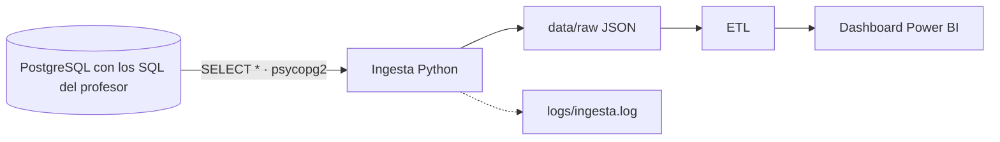
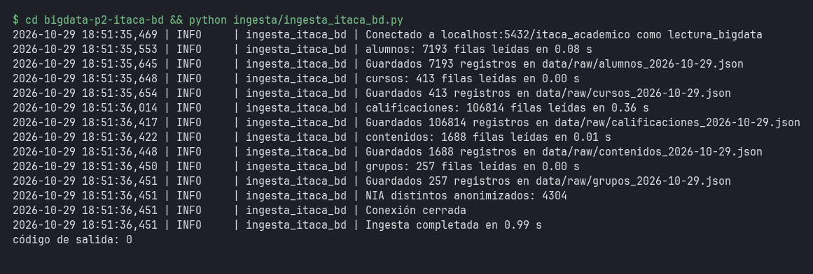
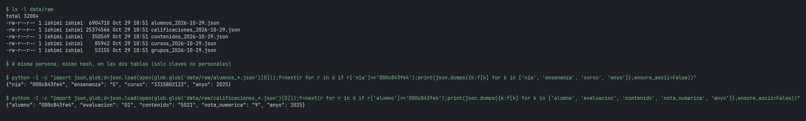

# Proyecto 2 · Analítica académica ITACA (origen base de datos)

> Proyecto del módulo **Big Data aplicado** (IABD). Práctica 2 del Bloque 1: la misma ingesta que la P1, pero leyendo de **PostgreSQL** por consultas SQL, y con un **logger** propio. Arquitectura batch.

## Descripción y objetivo

Volcar las tablas académicas de ITACA desde PostgreSQL (usuario de solo lectura) a la zona `raw` como JSON, tal cual están en la base. La única transformación es la anonimización del NIA. La base de origen se construye con los cinco ficheros SQL que el profesor da en Aules.

## Arquitectura



*Diagrama del Bloque 1. Se actualizará al terminar cada bloque.*

## Fuentes de datos

| Fuente | Mecanismo de acceso | Autenticación | Formato | Frecuencia de actualización | Última ingesta |
|---|---|---|---|---|---|
| Base PostgreSQL `itaca_academico`, creada y cargada con los 5 SQL del profesor (`alumnos`, `cursos`, `calificaciones`, `contenidos`, `grupos`: export de ITACA del CIPFP Mislata, cursos 2021-22 a 2025-26) | Conexión directa con `psycopg2`, el conector nativo de Python recomendado en el apartado 4 del bloque (JDBC puro se ve en el Bloque 4), y `SELECT *` por tabla | Usuario `lectura_bigdata`, solo `SELECT`; credenciales en `.env` (fuera de Git) | Filas relacionales -> JSON | Los SQL son una foto cerrada (la última exportación de las cabeceras es del 10/09/2026); en producción se volvería a ingestar tras cada exportación de ITACA | 2026-10-29 |

### Origen de los SQL (no se versionan)

Los cinco ficheros (`alumnos.sql`, `calificaciones.sql`, `contenidos.sql`, `cursos.sql`, `grupos.sql`, en el ZIP adjunto a la tarea de la Práctica 2 en Aules) se descargan de Aules y se dejan, **sin modificar**, en `sql/origen/`. Esa carpeta está en `.gitignore` y no se entrega. Cada SQL hace `DROP TABLE IF EXISTS` + `CREATE TABLE` + `INSERT`, por lo que se cargan con el usuario propietario mediante `sql/cargar_origen.sh`.

### Correspondencia enunciado -> SQL

El enunciado habla de cuatro y de cinco tablas. Se ingestan las cinco que da el profesor:

| Enunciado | Tabla / SQL | Observación |
|---|---|---|
| Alumnos | `alumnos` | Con el NIA anonimizado (paso 4) |
| Calificaciones | `calificaciones` | `alumno` es el NIA anonimizado (paso 4) |
| Módulos | `contenidos` | Es el equivalente de «módulos» en los SQL |
| Horas | no existe en el origen | No hay SQL de horas |
| Grupos | `grupos` | Viene en los SQL y se ingesta |
| Cursos | `cursos` | Es la tabla del paso 3 |

### Esquema del origen

Todas las columnas de los SQL son `TEXT` salvo `anyo` (`INTEGER`, curso académico: 2021 = 2021-22). No hay claves primarias ni foráneas.

| Tabla | Filas | Cabeceras de los SQL (una por curso) |
|---|---|---|
| `alumnos` | 7 193 | 1341 + 1411 + 1445 + 1465 + 1531 |
| `cursos` | 413 | 70 + 71 + 68 + 94 + 110 |
| `calificaciones` | 106 814 | 18906 + 20324 + 19130 + 22510 + 25944 |
| `contenidos` | 1 688 | 265 + 278 + 260 + 372 + 513 |
| `grupos` | 257 | 46 + 47 + 48 + 48 + 68 |

Los recuentos de la base y de los JSON coinciden con la suma de las cabeceras `· N filas` de cada bloque de los SQL.

**Qué se vuelca.** `SELECT *`: todas las columnas del origen, con el valor que tienen en la base. Los datos de ejemplo vienen ofuscados por el profesor; solo el NIA se anonimiza (HMAC-SHA256 con sal secreta, 10 hex, mismo hash en `alumnos.nia` y `calificaciones.alumno`). Para no dejar el orden del NIA original, `alumnos` y `calificaciones` se guardan ordenadas por el hash.

## Estructura del repositorio

| Carpeta / fichero | Contenido |
|---|---|
| `ingesta/ingesta_itaca_bd.py` | Ingesta (volcado): `conectar()`, `extraer_tabla()`, `anonimizar_nia()`, `guardar()` |
| `ingesta/logger.py` | Logger propio: `crear_logger(nombre)` |
| `sql/origen/` | Los 5 SQL del profesor (Aules). **No se versiona**: ver «Origen de los SQL» |
| `sql/cargar_origen.sh` | Ejecuta los 5 SQL con el usuario propietario dentro del contenedor, aplica permisos y cuenta filas |
| `sql/02_permisos.sql`, `sql/03_password_lectura.sh` | Usuario `lectura_bigdata` con `SELECT` solo sobre las cinco tablas y su contraseña desde `.env` |
| `etl/`, `dashboard/` | Bloques posteriores |
| `docs/` | Salida de la ingesta y capturas |
| `tools/render_captura.py` | Genera las capturas a partir de la salida real de los comandos |
| `docker-compose.yml` | PostgreSQL 16 local (`bigdata-pg-itaca`), publicado solo en 127.0.0.1; monta `./sql` en `/sql` (solo lectura) |
| `.env.example` | Plantilla de variables (el `.env` real no se versiona) |
| `data/raw/`, `logs/`, `entrega/` | Salidas locales, fuera de Git |

## Cómo desplegar el entorno

```bash
cp .env.example .env            # y cambia las contraseñas (DB_PASSWORD, DB_ADMIN_PASSWORD)
# descarga el ZIP de SQL de la tarea de Aules y deja los 5 .sql en sql/origen/ (alumnos, calificaciones, contenidos, cursos, grupos)
docker compose up -d            # PostgreSQL vacío (espera al healthcheck)
./sql/cargar_origen.sh          # crea y carga las tablas con los SQL, da SELECT a lectura_bigdata y cuenta filas
python -m venv .venv && source .venv/bin/activate
pip install -r requirements.txt
python ingesta/ingesta_itaca_bd.py
```

PostgreSQL queda en `localhost:5432` (si lo tienes ocupado, cambia `DB_PORT` en `.env`). `LOG_LEVEL` (`DEBUG`, `INFO`...) controla el detalle del log. Para empezar de cero: `docker compose down -v` (borra el volumen de este proyecto) y repetir los pasos.

## Requisitos

Docker con Compose, Python 3 con `pip` y los 5 SQL del profesor.

## Cómo desplegar el entorno

```bash
cp .env.example .env            # y cambia las contraseñas (DB_PASSWORD, DB_ADMIN_PASSWORD)
# descarga el ZIP de SQL de la tarea de Aules y deja los 5 .sql en sql/origen/ (alumnos, calificaciones, contenidos, cursos, grupos)
docker compose up -d            # PostgreSQL vacío (espera al healthcheck)
./sql/cargar_origen.sh          # crea y carga las tablas, da SELECT a lectura_bigdata y cuenta filas
python -m venv .venv && source .venv/bin/activate
pip install -r requirements.txt
python ingesta/ingesta_itaca_bd.py
```

PostgreSQL queda en `127.0.0.1:5432` (si lo tienes ocupado, cambia `DB_PORT` en `.env`). `LOG_LEVEL` (`DEBUG`, `INFO`, `WARNING`...) controla el detalle del log. Las rutas (`data/raw`, `data/.sal_nia`, `logs/`) son relativas a la raíz del proyecto, así que la ingesta se puede lanzar desde cualquier carpeta. Para empezar de cero: `docker compose down -v` (borra el volumen de este proyecto) y repetir los pasos.

## Bitácora de prácticas

### Bloque 0 · Entorno

- Objetivo: repositorio y PostgreSQL local con Docker.
- Pasos realizados: estructura del repo, `.gitignore` del módulo (más `logs/`), `docker-compose.yml` con PostgreSQL 16 publicado solo en 127.0.0.1, contraseñas en `.env`. Las tablas y el usuario de solo lectura se crean con `sql/cargar_origen.sh` a partir de los SQL del profesor, que aplica la contraseña de lectura con `sql/03_password_lectura.sh`.
- Problemas encontrados y solución: —
- Resultado: `docker compose ps` con `bigdata-pg-itaca` en estado *healthy*.

### Bloque 1 · Ingesta batch (P2)

- Objetivo: el mismo volcado de la P1, pero desde la base de datos con SQL, con el NIA anonimizado y con registro (logging) de lo que ocurre.
- Pasos realizados:
  1. Análisis de la fuente (sección «Fuentes de datos»): descarga del ZIP de SQL de la tarea de Aules y lectura de las cabeceras y del esquema de cada fichero.
  2. Entorno: `venv` con `psycopg2-binary`, `python-dotenv` y `pandas`. Credenciales en `.env` (`DB_HOST`, `DB_PORT`, `DB_NAME=itaca_academico`, `DB_USER=lectura_bigdata`, `DB_PASSWORD`), no versionado; `.env.example` sí.
  3. Base de origen: `docker compose up -d` + `sql/cargar_origen.sh`, que ejecuta con `psql` (dentro del contenedor y como propietario) los 5 SQL del profesor y después `sql/02_permisos.sql` (`SELECT` solo sobre esas cinco tablas; se retiran a `PUBLIC` los permisos de conexión y de tablas temporales) y `03_password_lectura.sh`.
  4. `ingesta/ingesta_itaca_bd.py`: `conectar()` (psycopg2 + `.env`, sesión en `readonly`), `extraer_tabla(conexion, tabla)` (`SELECT *` con la tabla como `psycopg2.sql.Identifier` y `RealDictCursor`), `guardar(datos, nombre)` (`data/raw/<tabla>_<fecha>.json`, UTF-8, `indent=2`, `default=str`) y un `__main__` que conecta, extrae, guarda y cierra la conexión en un `finally`. Si falla la conexión o la consulta, `logger.exception` y código de salida 1.
  5. Anonimización del NIA (`anonimizar_nia(nia)`): **HMAC-SHA256** con sal secreta en `data/.sal_nia` (permisos 600, fuera de Git), truncado a 10 hex y con caché por NIA, de modo que `alumnos.nia` y `calificaciones.alumno` reciben el mismo hash. Es la única transformación. `alumnos` y `calificaciones` se guardan ordenadas por el hash para no dejar el orden del NIA original.
  6. Logger propio (`ingesta/logger.py`, logger `ingesta_itaca_bd`): consola + fichero rotativo `logs/ingesta.log` (1 MB, 3 copias), formato `fecha | nivel | módulo | mensaje` y nivel por `LOG_LEVEL`. Se registran la conexión (sin contraseña), las filas y el tiempo por tabla y los errores.
  7. Comprobaciones finales: recuentos de filas y columnas de los JSON iguales a los de la base y a las cabeceras de los SQL; el NIA original no aparece en las columnas `nia`/`alumno`; el hash coincide entre alumnos y calificaciones; `lectura_bigdata` no puede hacer `INSERT`, `UPDATE`, `DELETE` ni crear tablas temporales (`permission denied`); con un puerto falso la ingesta registra el error y sale con código 1; con `LOG_LEVEL=WARNING` no salen los mensajes INFO.
- Problemas encontrados y solución:
  - **Esquema sin claves**: los SQL crean tablas sin PK ni FK; la ingesta no depende de ellas porque vuelca cada tabla entera.
  - **Todo es `TEXT`** salvo `anyo` (`INTEGER`): el volcado conserva los valores como están (códigos como `'028502'`, notas como texto).
  - **Diferencias con la P1 (XML)**: allí cada tabla era un XML y aquí se leen de una base con esquema propio (columnas en minúscula, `nia` en lugar de `NIA`). Los recuentos son los mismos que en la P1 (7 193 / 413 / 106 814 / 1 688 / 257).
  - Los hashes no coinciden con los de la P1 porque la sal es distinta; es lo esperado.
- Resultado: 5 tablas en `data/raw/` (7 193 alumnos, 413 cursos, 106 814 calificaciones, 1 688 contenidos, 257 grupos). Salida completa en [`docs/salida-ingesta.txt`](docs/salida-ingesta.txt) y en las capturas. Las capturas son renders (Pillow) de la salida real de los comandos, generados con `tools/render_captura.py`; no son capturas de pantalla del terminal. En la segunda se ve el mismo hash de NIA en alumnos y calificaciones, mostrando solo claves no personales.

  

  

  Los JSON de `data/raw/` no se suben a Git (están en `.gitignore`).

## Decisiones técnicas

| Decisión | Alternativa descartada | Motivo |
|---|---|---|
| Volcado puro: `SELECT *` y se guarda tal cual | Limpiar, validar o descartar columnas en la ingesta | La práctica es solo pasar los datos de la base a JSON. **No se trata ni se valida nada**: los problemas del origen (huérfanos, duplicados, espacios en lugar de nulos...) se dejan para el ETL del Bloque 4, donde el Proyecto 2 retoma estos datos |
| Se vuelcan todas las columnas; solo se hashea el NIA | Descartar columnas personales | Son datos de ejemplo ofuscados por el profesor; solo el NIA se anonimiza, como pide el paso 4 |
| PostgreSQL con `psycopg2` | Exportar a XML/CSV y leerlo | Datos relacionales y conector nativo de Python recomendado en el apartado 4 del bloque |
| Usuario `lectura_bigdata` solo con `SELECT`, y sesión en `readonly` | Usar el propietario de la base | Mínimo privilegio: la ingesta no puede modificar el origen |
| Postgres publicado solo en 127.0.0.1 | Publicarlo en todas las interfaces | No se expone la base a la red |
| Credenciales en `.env` (no versionado) + `.env.example` | Contraseñas en el código o en el compose | No se suben secretos a Git |
| `psycopg2.sql.Identifier` para el nombre de tabla | f-string con la tabla | Evita inyección SQL y errores de comillas |
| SQL del profesor sin versionar (`sql/origen/`, en `.gitignore`) | Subirlos al repositorio | Son datos del alumnado aunque estén ofuscados; se descargan de Aules |
| Cargar los SQL con `psql` dentro del contenedor y como propietario | Cargarlos con el usuario de lectura | Los SQL hacen `DROP/CREATE/INSERT` (necesitan propietario) |
| HMAC-SHA256 con sal secreta, truncado a 10 hex | Hash simple del NIA | Un hash sin sal de un NIA se deshace probando todos los valores |
| Módulo propio `logger.py` con fichero rotativo y `LOG_LEVEL` | Solo `logging.basicConfig` | Histórico en disco acotado y nivel configurable sin tocar el código |

## Incidencias resueltas

| Incidencia | Solución |
|---|---|
| Los `DROP TABLE` de los SQL borran los privilegios del usuario de lectura | Los permisos se aplican después de cargar (`sql/cargar_origen.sh` ejecuta `02_permisos.sql`) |
| `LOG_LEVEL` del `.env` se ignoraba | `load_dotenv()` se llama antes de crear el logger |
| Rutas relativas al directorio actual | Se calculan desde la raíz del proyecto con `Path(__file__)` |
